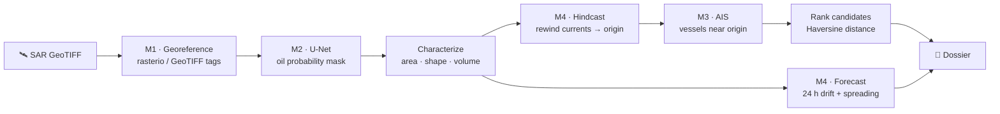
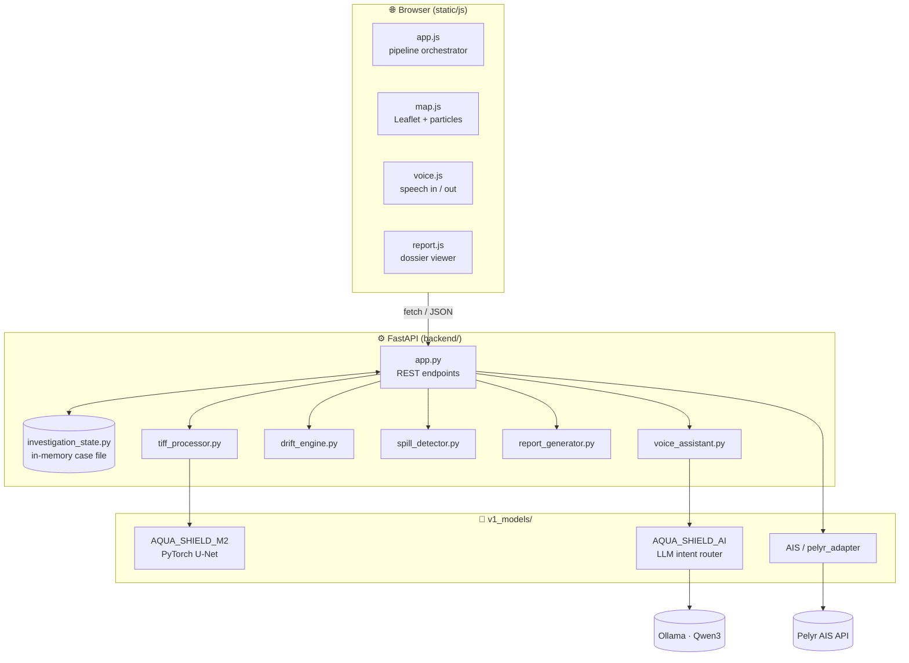

<div align="center">

# 🛡️ Aqua Shield

### Autonomous Ocean Intelligence & Maritime Oil-Spill Forensics

*From a satellite image to a ranked list of suspect vessels, in one browser tab.*


-black)


[Quick Start](#-quick-start) · [How It Works](#-how-it-works) · [Architecture](#-architecture) · [API](#-api-reference) · [Limitations](#%EF%B8%8F-limitations--honest-status) · [Team](#-team)

</div>

---

## 📌 Overview

An oil slick shows up on a satellite radar image hours after it was dumped, and by then the ship that released it is long gone. **Aqua Shield** works backwards to the discharge point and the ships that could have caused it:

1. **Detects** the dark slick in a Sentinel-1 SAR image with a U-Net neural network.
2. **Characterizes** it: area, shape, estimated volume and weathering.
3. **Rewinds** ocean currents to estimate *where* the oil was released (hindcast).
4. **Ranks** nearby vessels from AIS ship-tracking data by distance to that origin.
5. **Forecasts** where the slick will drift over the next 24 hours.
6. **Generates** an evidence dossier with MARPOL Annex I references.

Everything happens in a single map-based dashboard. You can drive it with clicks or by voice ("*Rewind 6 hours to the origin*") through a local LLM.

> **Results are leads, not proof.** Rankings show which vessels deserve a closer look. They do not establish legal responsibility. See [Limitations](#%EF%B8%8F-limitations--honest-status).

---

## ✨ Features

| | Feature | Details |
|---|---|---|
| 🛰️ | **SAR GeoTIFF ingestion** | Reads location from GeoTIFF tags (rasterio, with a PIL fallback); asks for manual lat/lng when the image has none |
| 🧠 | **Deep-learning detection** | PyTorch U-Net (1-channel SAR → oil probability mask), tiled 512×512 inference |
| 📐 | **Slick characterization** | Area, perimeter, axes, eccentricity, compactness, fractal dimension, volume & mass estimate |
| 🌊 | **Ocean drift engine** | Lagrangian particle tracking on NetCDF current fields, backward (hindcast) and forward (forecast) |
| 🚢 | **Live vessel intelligence** | Pelyr AIS API: ships within 250 km, per-vessel tracks, rate-limit handling and caching |
| 🎯 | **Candidate ranking** | Vessels ranked by great-circle (Haversine) distance to the reconstructed origin |
| 🗺️ | **Interactive map** | Leaflet + ESRI satellite imagery, animated flow particles, rotating ship icons |
| 🎙️ | **Voice assistant** | Browser speech-to-text → intent routing (keywords → local Qwen3 via Ollama) → spoken reply |
| 📄 | **Forensic dossier** | One-click report with printable / save-as-PDF output |
| ⚡ | **One-click launch** | `start.bat` sets up everything and opens the app |

---

## 🚀 Quick Start

### Option A: one click (Windows)

```text
Double-click  start.bat
```

It finds Python, creates a `venv`, installs dependencies (first run only), loads `.env`, checks the model file, and opens **http://localhost:8000**. Close the window to stop the server.

> ⏳ The first run downloads PyTorch (~1 GB) and can take 10+ minutes. Later launches take seconds.

### Option B: manual (any OS)

**Prerequisites:** Python 3.9+, Git, [Git LFS](https://git-lfs.com/)

```bash
# 1. Clone (Git LFS is required for the 160 MB model weights)
git lfs install
git clone <your-repo-url> aqua-shield
cd aqua-shield
git lfs pull

# 2. Create and activate a virtual environment
python -m venv venv
source venv/bin/activate          # Windows: venv\Scripts\activate

# 3. Install dependencies
pip install -r requirements.txt

# 4. (Optional) Live AIS data: export your Pelyr key
export PELYR_API_KEY=your_key     # Windows PowerShell: $env:PELYR_API_KEY="your_key"

# 5. Run
python run.py
```

The browser opens automatically. Interactive API docs (Swagger) are at **http://localhost:8000/docs**.

### Try it

1. Click **☁️ Upload** and choose `TEST_EVIDENCE/satellite/TEST_SAR_001.tif`.
2. Click the steps in the left panel in order: **Rewind → Vessel Analysis → Correlation → Forecast → Report**.
3. Or click the 🎙️ orb and say *"Generate investigation report"*.

---

## ⚙️ Configuration

The manual setup doesn't read `.env` automatically, so export variables in your shell. `start.bat` loads `.env` for you.

| Variable | Used by | Default | Purpose |
|---|---|---|---|
| `PELYR_API_KEY` | AIS adapter | *(empty)* | Enables live vessel positions & tracks. Without it, vessel steps return no ships |
| `PELYR_BASE_URL` | AIS adapter | `https://api.pelyr.com/v1` | Pelyr API endpoint |
| `OLLAMA_HOST` | AI router | `http://127.0.0.1:11434` | Local Ollama server |
| `OLLAMA_MODEL` | AI router | `qwen3:1.7b` | Model used to understand voice commands |
| `OLLAMA_TIMEOUT` | AI router | `90` | LLM request timeout (seconds) |
| `GFW_API_ACCESS_TOKEN` | GFW adapter (optional) | *(placeholder)* | Global Fishing Watch alternative AIS source |
| `HOST` / `PORT` | `backend/app.py` | `0.0.0.0` / `8000` | Only when running `python backend/app.py` directly; `run.py` always uses port 8000 |

**Voice AI (optional):** install [Ollama](https://ollama.com), then run `ollama pull qwen3:1.7b`. Without it, voice commands still work through the built-in keyword matcher.

---

## 🔬 How It Works



| Step | What happens | Where in the code |
|---|---|---|
| **1–2 · Detect** | Image location is found from GeoTIFF tags. The image is normalized to 0–1, cut into 512×512 tiles, and each tile goes through the U-Net (threshold 0.45). Results are stitched back together and oil pixels are counted (10 m × 10 m each) | `backend/tiff_processor.py`, `v1_models/AQUA_SHIELD_M2/` |
| **3 · Characterize** | Shape metrics are derived from the area using an ellipse model; volume = area × 300 µm assumed thickness | `backend/models/spill_detector.py` |
| **4 · Rewind** | The spill center is stepped back hour by hour against the current: `Δlat = −v·Δt / R`, `Δlng = −u·Δt / (R·cos φ)` | `backend/models/drift_engine.py` |
| **5 · Vessels** | Live ships within 250 km come from Pelyr (bounding-box query, then a Haversine filter) | `v1_models/AIS/M3_handoff/src/queries/pelyr_adapter.py` |
| **6 · Correlate** | Ships are sorted by distance to the reconstructed origin | `backend/app.py` → `/api/compare_vessels` |
| **7 · Forecast** | Same advection run forward; area grows as `A(t) = A₀ · (1 + 0.05·t)` | `backend/models/drift_engine.py` |
| **8 · Report** | All results are assembled into a structured dossier and rendered in the browser | `backend/report_generator.py`, `static/js/report.js` |

**Voice commands** go through `browser speech → /api/voice_command → keyword rules → (fallback) Qwen3 via Ollama → whitelisted tool → spoken reply + map action`. The LLM can only pick from 8 allowed tools; anything else is rejected.

---

## 🏗️ Architecture



### Project structure

```text
aqua-shield/
├── start.bat                     # One-click Windows launcher
├── run.py                        # Starts Uvicorn + opens the browser
├── requirements.txt
├── .env.example                  # Template for API keys
│
├── backend/                      # FastAPI server
│   ├── app.py                    # All REST endpoints (entry point)
│   ├── config.py                 # Paths, defaults, demo-case constants
│   ├── investigation_state.py    # In-memory "case file" per investigation
│   ├── tiff_processor.py         # Upload → georeference → U-Net
│   ├── report_generator.py       # Builds the forensic dossier
│   ├── voice_assistant.py        # Voice intent → backend action
│   └── models/
│       ├── spill_detector.py     # Slick geometry & weathering
│       ├── drift_engine.py       # Hindcast / forecast advection
│       ├── ais_correlator.py     # Historical AIS correlation (stub)
│       └── checkpoints/best_model.pth   # U-Net weights (Git LFS)
│
├── static/                       # Front end
│   ├── css/aquashield-theme.css  # Glassmorphism UI theme
│   └── js/                       # app · map · voice · report · timeline
├── templates/index.html          # Dashboard page (Jinja2)
│
├── v1_models/                    # Standalone modules
│   ├── AQUA_SHIELD_M2/           # U-Net model, tiling, inference CLI
│   ├── AQUA_SHIELD_AI/           # Ollama LLM intent router + CLI
│   └── AIS/M3_handoff/           # AIS adapters, cleaning & trajectory pipeline
│
└── TEST_EVIDENCE/                # Sample SAR scenes, AIS tracks, ocean data
```

Every source file starts with a header comment explaining its role, so the code is meant to be read top to bottom.

---

## 📡 API Reference

Full interactive docs: **`/docs`** (Swagger UI) or **`/redoc`**.

<details>
<summary><b>Investigation lifecycle</b></summary>

| Method | Endpoint | Description |
|---|---|---|
| `GET` | `/` | Dashboard UI |
| `GET` | `/api/health` | Server status and active case ID |
| `POST` | `/api/new_investigation` | Start a fresh case (clears state) |
| `GET` | `/api/current_investigation` | Full state of the active case |

</details>

<details>
<summary><b>Detection & characterization</b></summary>

| Method | Endpoint | Description |
|---|---|---|
| `POST` | `/api/upload_evidence` | Multipart upload: `file` (GeoTIFF), optional `manual_lat`, `manual_lng` |
| `POST` | `/api/analyze_spill` | Characterization of the detected slick |
| `POST` | `/api/analyze_geometry` | Shape metrics |
| `POST` | `/api/estimate_slick_age` | Age & weathering estimate |
| `POST` | `/api/explain_detection` | Checklist of what has run + model limitations |
| `POST` | `/api/get_evidence` | Evidence source list |

</details>

<details>
<summary><b>Ocean drift</b></summary>

| Method | Endpoint | Body | Description |
|---|---|---|---|
| `POST` | `/api/find_probable_origin` | `{"hours": 6}` | Backward drift → probable discharge point |
| `POST` | `/api/forecast_spill` | `{"hours": 24}` | Forward drift + spreading → future plume |

</details>

<details>
<summary><b>Vessels (AIS)</b></summary>

| Method | Endpoint | Description |
|---|---|---|
| `POST` | `/api/find_nearby_vessels` | Live ships within 250 km (and the subset within 35 km) |
| `POST` | `/api/compare_vessels` | Ranked candidates by distance to the origin |
| `POST` | `/api/get_vessel_trajectory` | `{"vessel_id": "<MMSI>"}`: recent track |
| `GET` | `/api/live_vessel_track/{mmsi}` | Same, by URL |

</details>

<details>
<summary><b>Assistant & reporting</b></summary>

| Method | Endpoint | Description |
|---|---|---|
| `POST` | `/api/voice_command` | `{"query": "..."}` → `speech_response`, `ui_action`, `data` |
| `POST` | `/api/search` | Header search box |
| `POST` | `/api/generate_report` | Full forensic dossier (JSON) |

</details>

**Example:**

```bash
curl -F "file=@TEST_EVIDENCE/satellite/TEST_SAR_001.tif" http://localhost:8000/api/upload_evidence
curl -X POST -H "Content-Type: application/json" -d '{"hours": 6}' http://localhost:8000/api/find_probable_origin
```

---

## ⚠️ Limitations & Honest Status

Aqua Shield is a **prototype**. This section says where it falls short, so nobody has to find out the hard way.

**Model & data**
- **The U-Net is weak.** Validation Dice is **7.94%** (IoU 4.13%, precision 4.45%, recall 36.9%), so it flags many dark areas that aren't oil (wind shadows, natural seeps, calm water).
- **Large files use Git LFS.** The model weights and `TEST_OCEAN_001.nc` arrive as small pointer files unless you run `git lfs pull`.
- **Placeholder detection values.** When the model can't run or detects nothing, the area and confidence come from a deterministic placeholder based on the filename. Treat those numbers as demo values, not measurements.
- **Partly fixed characterization.** Age, evaporation, emulsification and radar/optical indices are fixed reference values. Only area-dependent quantities (volume, mass, shape) are computed.

**Physics**
- **Simple integration.** The drift engine moves one particle per step (forward-Euler). The labels say "RK4", but no RK4 is implemented yet. Without the NetCDF file, it uses a constant default current.
- **Simple spreading model.** The forecast grows the area linearly (`A₀·(1+0.05t)`), and the plume outline is a fixed shape.

**Attribution**
- **Live AIS shows ships *now*, not at spill time.** Ranking live ships against a past spill is an investigative lead only.
- **The test scenes contain no spills.** The bundled "real AIS scenes" are US East Coast images with ships in them, useful for testing the AIS pipeline.
- **No ranking is legal proof.** Confirming a source needs physical evidence: oil fingerprinting, the ship's oil record book, inspection.

**Engineering**
- **One shared case.** State lives in memory: one case shared by all users, lost on restart.
- **Open CORS, no auth, no upload size limits.** Fine for local demos only.
- **Known UI gaps.** The timeline scrubber has no backend route yet, and some report fields show N/A.

---

## 🗺️ Roadmap

- [ ] Retrain the U-Net on a larger labelled SAR oil-spill dataset; report detection failures instead of using placeholders
- [ ] Real RK4 integration with time-varying currents and wind drift (leeway)
- [ ] Historical AIS for the incident time window, so ranking uses positions *at spill time*
- [ ] Per-user sessions and persistent case storage
- [ ] Contour-accurate slick polygons from the actual mask
- [ ] Server-side PDF export and an automated test suite

---

## 🧰 Tech Stack

**Backend:** FastAPI · Uvicorn · Pydantic · PyTorch · NumPy · rasterio · Pillow · xarray / netCDF4
**Frontend:** Vanilla JS · Leaflet · Canvas 2D · Web Speech API · Jinja2
**AI:** Ollama · Qwen3 1.7B (local, offline)
**Data:** Sentinel-1 SAR · Pelyr AIS · COPERNICUS / HYCOM currents · Global Fishing Watch (optional)
**Data engineering (M3):** DuckDB · Polars · pandas · Parquet

---

## 🛠️ Troubleshooting

| Problem | Fix |
|---|---|
| `Python was not found` | Install Python 3.9+ and tick **"Add Python to PATH"** |
| Model warning on startup | Clone with Git, then `git lfs install && git lfs pull` |
| No vessels appear | Set `PELYR_API_KEY` (in `.env` for `start.bat`, or export it) |
| Voice button does nothing | Use Chrome or Edge and allow microphone access; otherwise a text prompt appears |
| Voice answers slowly | Ollama is optional; stop it, or use the quick-command chips |
| Port 8000 already in use | Close the other app using it, or run `uvicorn backend.app:app --port 8001` |

---

## 👥 Team

<div align="center">

**Team Aqua Shield**

| Yuvraj | Ishant |
|:---:|:---:|

</div>
